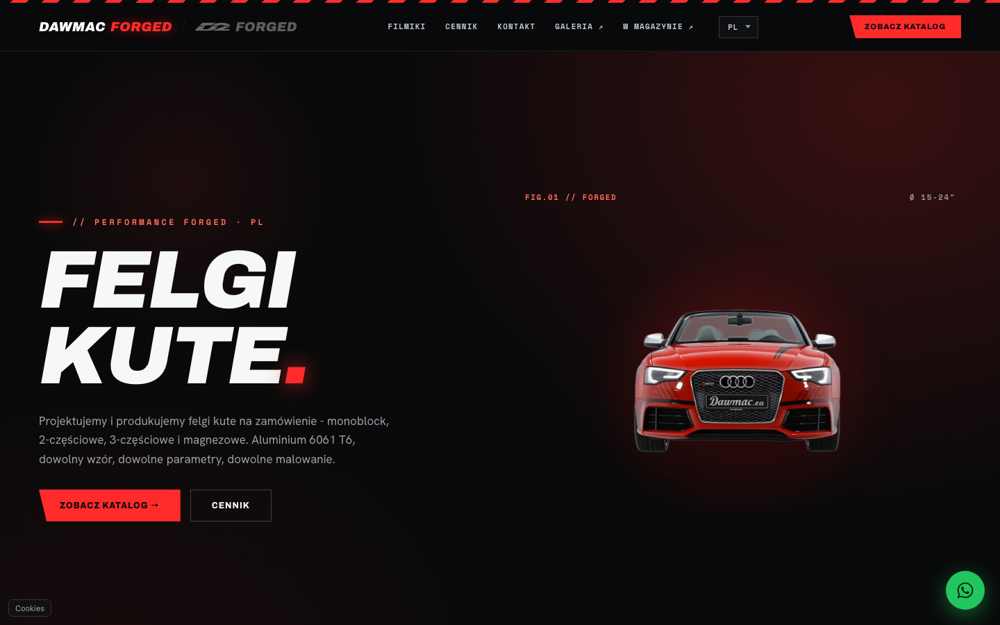
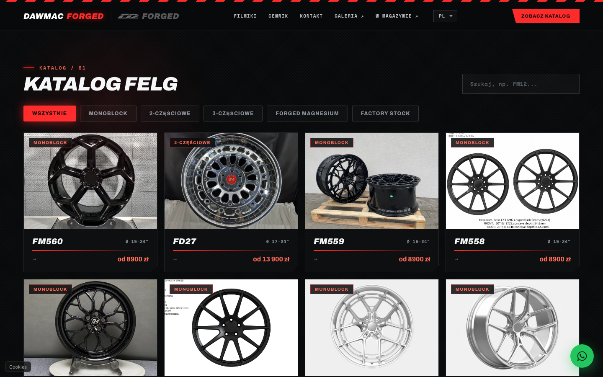
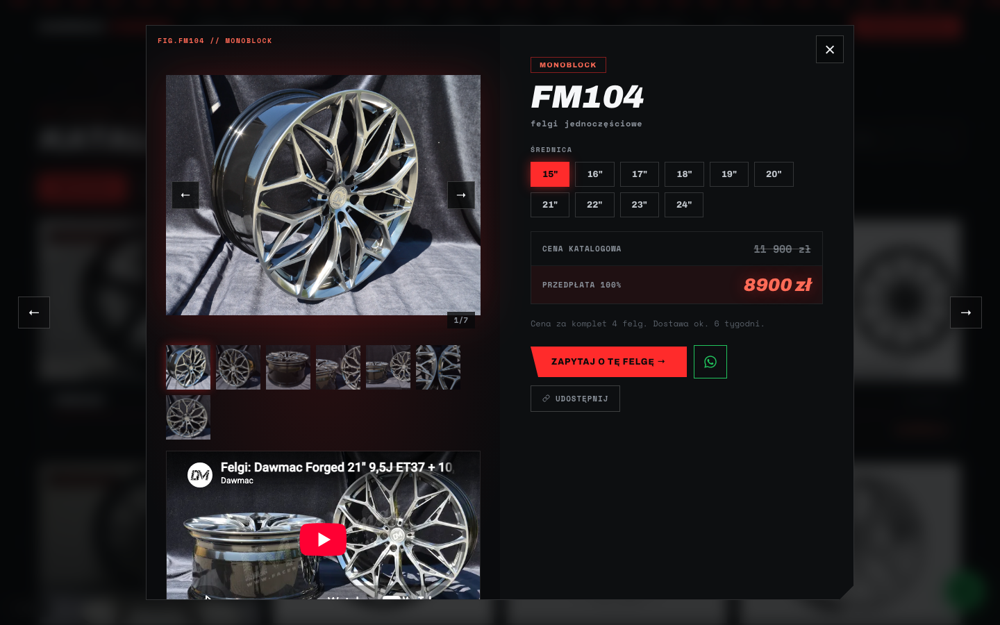
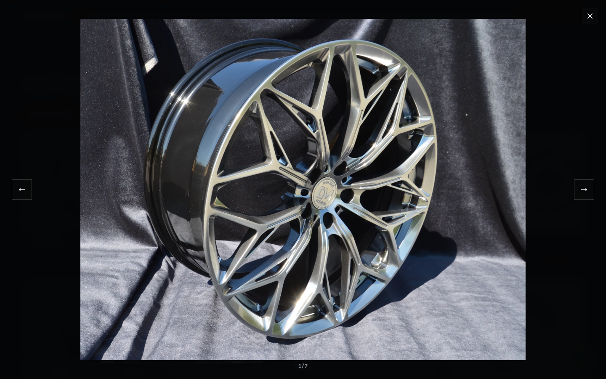
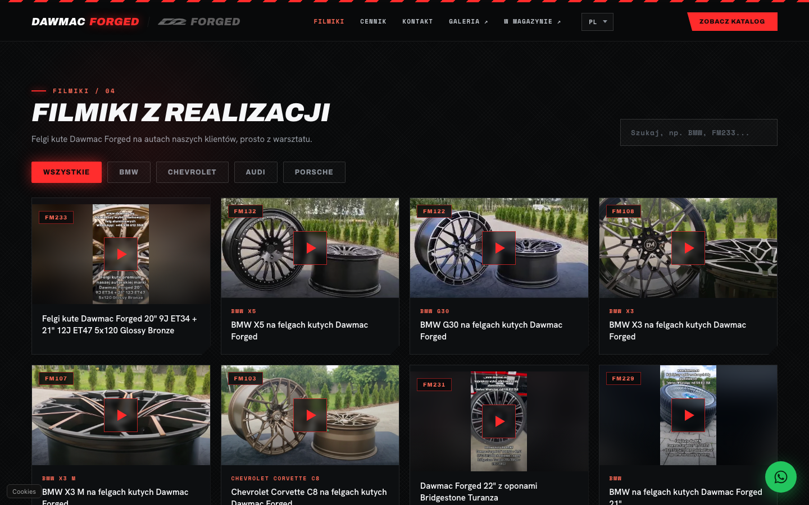
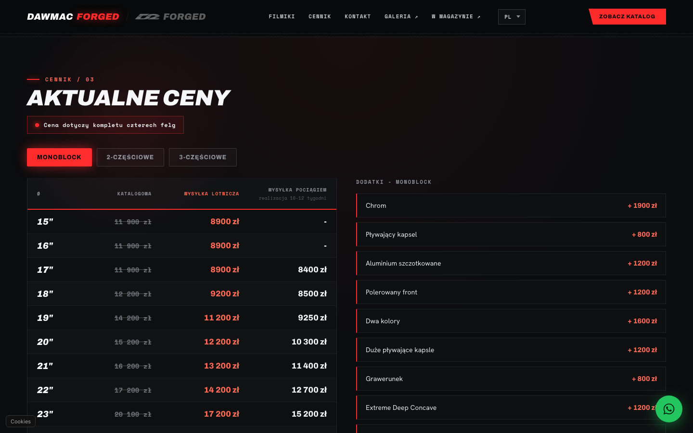
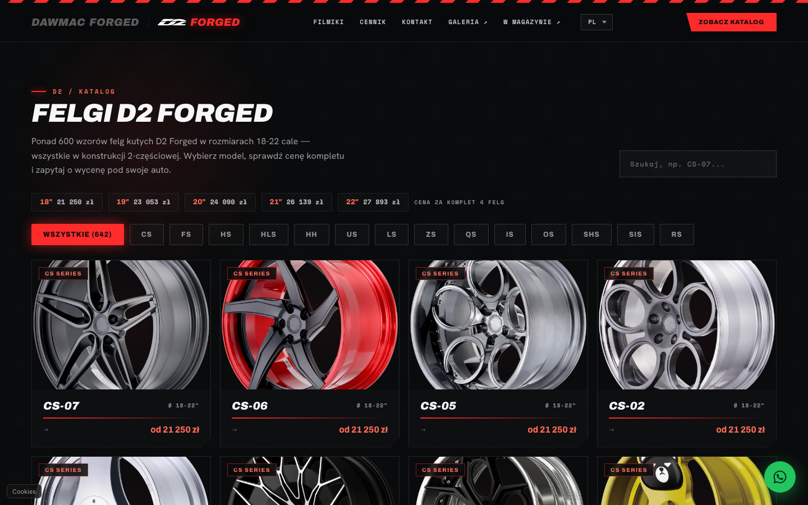
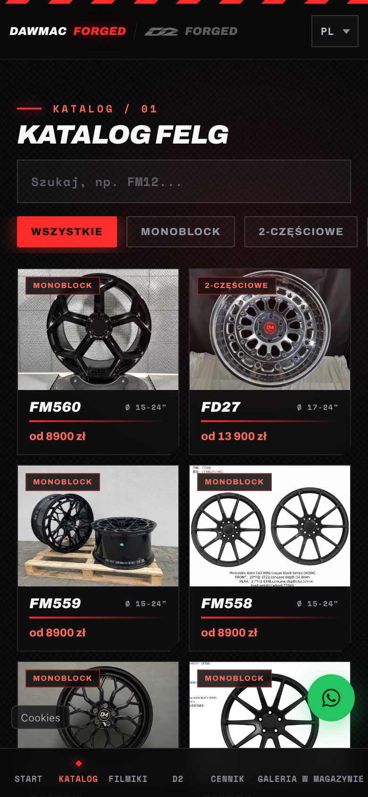
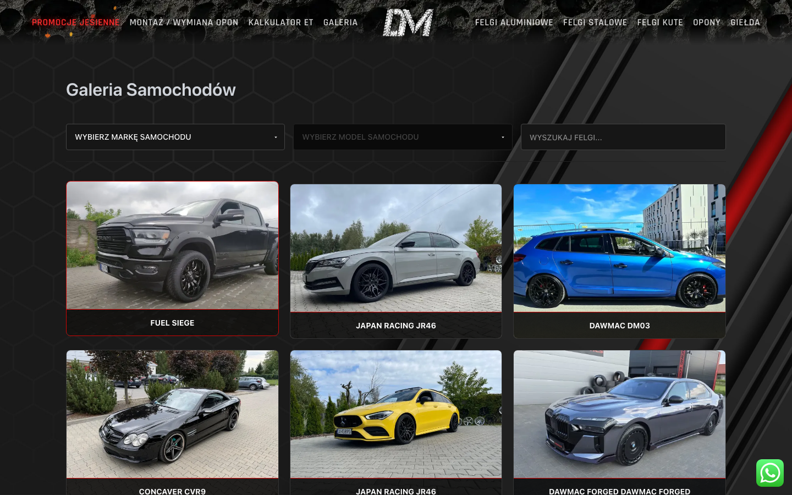

# Dawmac Digital Ecosystem

> The source code lives in a private repository. This page is a showcase of what was built.

🔗 **Main shop:** [dawmac.pl](https://dawmac.pl/)
💎 **Forged wheels showcase:** [forged.dawmacpolska.pl](https://forged.dawmacpolska.pl/)
📸 **Customer cars gallery:** [dawmac.pl/galeria](https://dawmac.pl/galeria/)

Dawmac is a Polish wheel retailer and manufacturer of custom forged rims. Over the last year I built and maintain the software around the business: a showcase site for forged wheels, an admin panel with a REST API, a gallery of customer cars, extensions for the WooCommerce shop and an Allegro marketplace integration — all fed from one shared database.

## 1. Forged wheels showcase — `forged.dawmacpolska.pl`

**React 19 · TypeScript · Vite · PHP for bot previews and the contact form**

A single-page app for presenting made-to-order forged wheels, with two brands under one roof (Dawmac Forged and the D2 Forged catalog of 640+ designs).

- Scroll-driven hero: a 101-frame image sequence drawn on `<canvas>`, synced to scroll with easing
- Catalog with series filters, search and infinite scroll; wheel cards open as shareable deep links (`/wheel/FM104`)
- Full-screen photo viewer with natural zoom: pinch on phones and trackpads, drag to pan, double-tap / click to zoom, swipe between photos
- Price list per series and size with two shipping options; shareable `/cennik` link
- "Build videos" section: YouTube videos of customer cars with brand filters, a privacy-friendly player (youtube-nocookie) and `VideoObject` structured data
- Server-side Open Graph previews for WhatsApp / Facebook / Messenger bots on every deep link (wheels, videos, price list)
- Three languages (PL / EN / DE), mobile app-style bottom navigation, GDPR consent with Google Consent Mode

| Catalog | Wheel card | Photo zoom |
|---|---|---|
|  |  |  |

| Build videos | Price list | D2 Forged catalog |
|---|---|---|
|  |  |  |

## 2. Admin panel and REST API

**PHP 8 · MySQL · React admin panel**

- One API serving the forged site, the shop gallery and the panel
- Wheel management with automatic per-series numbering, photo ordering and a primary photo
- Build-video management: paste a YouTube link, the panel fetches the title, detects vertical Shorts and stores an optimised WebP thumbnail locally
- API keys for external tools (hashed, revocable, issued only from the panel)
- Image pipeline generating WebP thumbnails

## 3. Customer cars gallery — `dawmac.pl/galeria`

**WordPress plugin + shared API**

- Browse thousands of customer installations, filter by car make and model, search by wheel
- Wheel names normalised across the gallery and the shop, so every product page automatically shows real cars on that wheel

## 4. Shop extensions — `dawmac.pl` (WooCommerce)

- Custom product filter plugin for a catalogue of 30,000+ wheels and tyres, with result counts that match the listing
- Automated Allegro listings: OAuth2 client, mapping products to Allegro parameters, daily price sync and an offer auditor

## 5. Internal iOS app

**Swift · SwiftUI** — a worker app for adding wheels and gallery photos from the workshop floor.

---

*Designed, developed and maintained by Hubert.*
